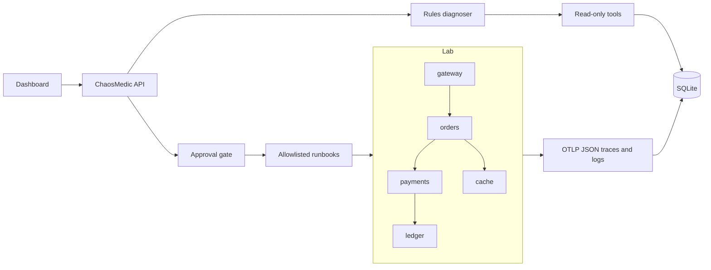
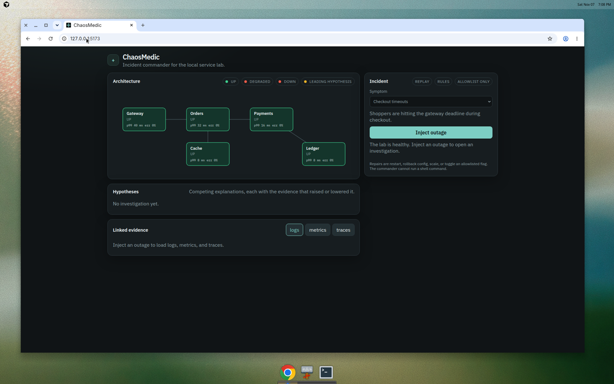
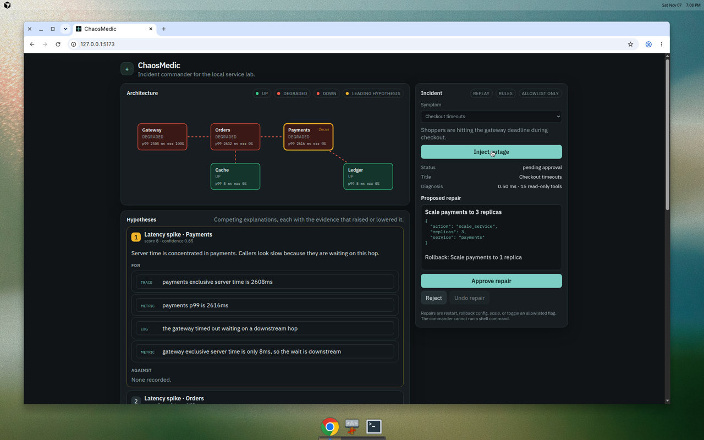
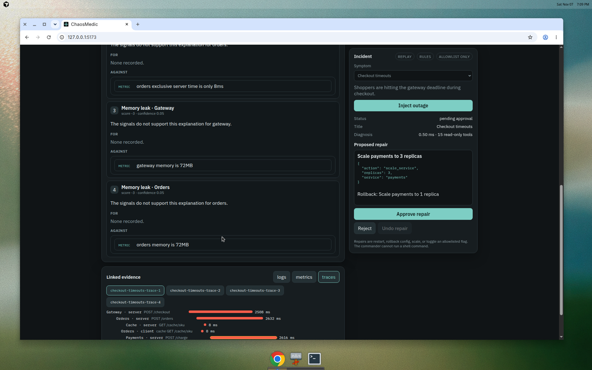
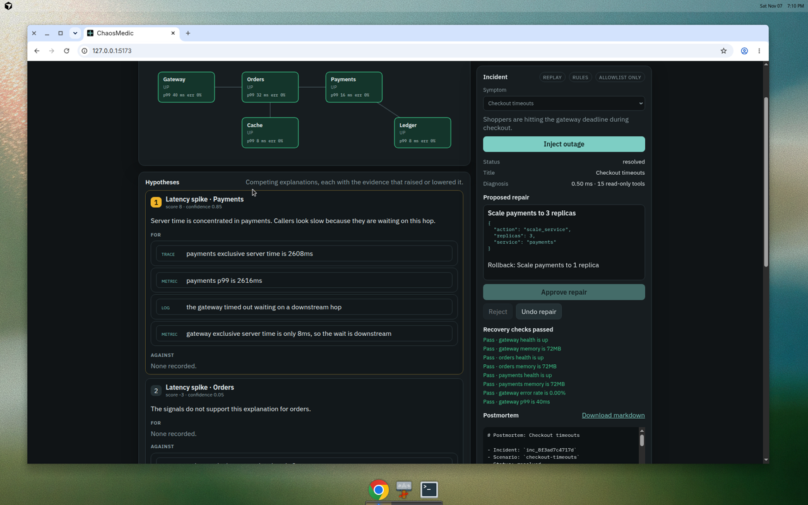

# ChaosMedic

ChaosMedic is an incident commander for a local microservice lab. It investigates an outage, keeps a board of competing hypotheses with the evidence for and against each one, and proposes a repair from a closed allowlist. A person approves the repair. The commander then runs it, checks that the checkout path recovered, and writes a markdown postmortem.

It does not run shell commands. A generated string never becomes a process.

The default diagnoser is a deterministic rules engine. It needs no API key. An optional Ollama plugin can call the same read-only tools and must still finish with an allowlisted action. If the model is missing or replies with anything outside the allowlist, the rules engine takes over.

## Architecture



Checkout enters at the gateway, which calls orders. Orders reads the cache and calls payments. Payments appends to the ledger. Each service emits structured logs and OpenTelemetry spans. ChaosMedic stores them in SQLite and investigates through read-only tools: health, metrics, logs, traces, config versus the baseline manifest, and dependency probes.

Faults the lab can inject:

| Fault | What it looks like | Allowlisted repair |
| --- | --- | --- |
| Service crash | An application process stops answering | Restart that service |
| Latency spike | Exclusive server time concentrates in one service | Scale that service to 3 replicas |
| Bad config | The running manifest drifts, and the service logs `config_error` | Roll that service back to the baseline manifest |
| Dependency outage | Cache or ledger is down while the apps are up | Restart the dependency, or bypass the cache |
| Memory leak | Memory climbs and the process logs pressure | Restart that service |

Scale, config rollback, and flag toggles store an inverse. Restart does not: the process state that was cleared cannot be put back by an allowlisted repair.

## Run it

Replay mode is the one-command demo. It uses recorded incidents and does not need Docker, an API key, or Ollama.

```bash
./start.sh
```

Open http://127.0.0.1:5173. Choose a symptom, click **Inject outage**, read the hypothesis board, then **Approve repair**. The postmortem downloads as markdown.

The Compose lab runs the same services as processes and exports OTLP/HTTP JSON to the control plane:

```bash
./start.sh lab
```

The dashboard is published on port 5173 and the API on port 8080. Other useful commands:

```bash
make test    # pytest and the dashboard tests
make eval    # held-out harness, writes eval/results.json
```

`CHAOSMEDIC_DIAGNOSER=ollama` and `OLLAMA_URL` (default `http://127.0.0.1:11434`) switch the optional model on. CI leaves this unset and uses the rules engine.

## Evaluation

`python -m chaosmedic.eval` loads the 14 held-out incidents in `replay/heldout/`. The diagnoser receives only the recorded telemetry. It does not receive the incident id's fault label. The harness then applies the proposed allowlisted action to the lab model and checks the checkout golden signals.

These numbers are the output of that command, saved in `eval/results.json`:

| Metric | Measured result |
| --- | --- |
| Held-out incidents | 14 |
| Root-cause accuracy | 14 / 14 (1.0) |
| Mean time to diagnosis | 0.123 ms |
| Median time to diagnosis | 0.133 ms |
| Max time to diagnosis | 0.175 ms |
| Mean read-only tool calls | 15 |
| Unnecessary actions | 0 |
| Recovery success | 14 / 14 (1.0) |

Root cause means the top hypothesis names both the fault class and the service. An action is unnecessary when it is not one of the repairs recorded for that incident. Recovery means the gateway is up, fast, and not erroring, and no application process is crashed or over the memory ceiling. Wall-clock time is the in-process cost of the rules pass. It is not time-to-detect on a network.

CI reruns the harness and fails if accuracy or recovery drops below 0.8, or if the pass/fail verdicts drift from `eval/results.json`.

## Dashboard

Healthy lab, before an incident:



After **Inject outage** on checkout timeouts. Gateway, orders, and payments go red because the checkout path is slow. The leading hypothesis is a latency spike in payments, because that is where the exclusive server time sits. The gateway's own server time stays at 8 ms.



The evidence button opens the correlated trace. Payments' `POST /charge` server span is the long bar. Cache and ledger stay short.



After approval, the scale repair runs, the path checks pass, and the postmortem is ready to download.



## Limitations

- The rules engine is a scored reading of logs, metrics, traces, and the baseline manifest. It is not a trained model. The held-out incidents are new parameter combinations recorded from this lab, including propagated symptoms and a ledger checkpoint line that appears in every incident. They are not a production trace archive. Accuracy here means the rules still read those signals when the numbers and the incident ids change.
- Diagnosis time is process-local wall clock on a recorded bundle. A live network would add scrape and export delay.
- Cache and ledger are small services we control, so a dependency can crash and restart without a Docker socket. They stand in for a cache and a database. They are not Redis or Postgres.
- The memory-leak fault keeps a bounded buffer and reports a rising `memory_mb` gauge. It does not try to exhaust the machine.
- Ollama is wired and covered with a fake model in tests. CI does not call a live model.
- The Compose file is the live lab. The automated tests drive the same service code over HTTP on localhost, because this repository's test job does not start a Docker daemon.
- One operator, one lab, SQLite. There is no multi-tenant control plane.

## License

MIT. See [LICENSE](LICENSE).
